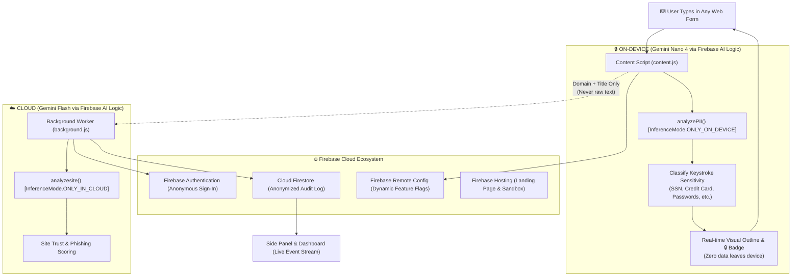

# 🛡️ InputGuard — AI Privacy Bodyguard for Everything You Type

> **#BuildHybridAI 2026** — Official Hackathon Submission  
> Built with **Firebase AI Logic** combining on-device **Gemini Nano 4** and cloud-hosted **Gemini Flash**.

---

## 📌 Overview

**InputGuard** is a Chrome extension and full-stack web application that watches what you type in real time and warns you before you leak sensitive information (SSNs, credit cards, credentials, API keys) into untrusted or malicious web forms.

**Zero keystroke data ever leaves your device.** 

- **🔒 On-Device (`InferenceMode.ONLY_ON_DEVICE` via Gemini Nano 4):** Evaluates keystroke sensitivity with millisecond latency right inside your browser sandbox. Works 100% offline.
- **☁️ Cloud (`InferenceMode.ONLY_IN_CLOUD` via Gemini Flash):** Evaluates website domain reputation and phishing risk — receiving only the domain and page title, never your raw inputs.

---

## 🏆 System Architecture



---

## 🔥 6 Firebase Products Integrated at Runtime

InputGuard strictly adheres to the hackathon rule: *all AI inference runs through Firebase AI Logic at runtime.*

| Product | Role in InputGuard | Source Location |
|---|---|---|
| **Firebase AI Logic** | On-device Gemini Nano 4 (`ONLY_ON_DEVICE`) + cloud Gemini Flash (`ONLY_IN_CLOUD`). | `src/firebase/ai-engine.js` |
| **Firebase App Check** | Secures cloud inference and client requests with debug tokens/reCAPTCHA Enterprise. | `src/firebase/config.js` |
| **Firebase Authentication** | Zero-friction anonymous sign-in isolating user audit logs and settings. | `src/popup/popup.js`, `src/background.js` |
| **Cloud Firestore** | Stores anonymized security incident logs (domain, category, timestamp — never raw text). | `src/sidepanel/sidepanel.js` |
| **Firebase Remote Config** | Dynamically gates on-device AI and cloud checks at runtime without redeploying. | `src/content/content.js` |
| **Firebase Hosting** | Serves the public landing page, interactive demo sandbox, and web dashboard. | `public/`, `firebase.json` |

---

## 🧪 How to Test the App (Step-by-Step Guide)

You can test InputGuard **locally in under 3 minutes**!

### Step 1: Build the Extension

Ensure you are in the `inputguard` directory:

```bash
cd inputguard
npm install
npm run build
```

This compiles all TypeScript/ES modules into the production-ready `dist/` folder.

---

### Step 2: Load the Extension into Google Chrome

1. Open **Google Chrome** (Chrome 139+ recommended for native Gemini Nano).
2. In the address bar, navigate to:
   ```text
   chrome://extensions
   ```
3. In the top-right corner, toggle **Developer mode** to **ON**.
4. Click the **Load unpacked** button in the top-left.
5. Select the `dist` folder located at:
   ```text
   d:\Personal\Opencode\Google firebase\inputguard\dist
   ```
6. You will see **InputGuard** appear in your extension list with its blue shield icon!

*(Optional Chrome AI Flag)*: To enable native Gemini Nano on-device AI in Chrome:
- Navigate to `chrome://flags/#prompt-api-for-gemini-nano` → Set to **Enabled**.
- Navigate to `chrome://flags/#optimization-guide-on-device-model` → Set to **Enabled Bypass Requirement**.
- Relaunch Chrome. *(Note: InputGuard automatically uses local regex fallback if Gemini Nano is not enabled on your hardware, so the demo works regardless).*

---

### Step 3: Test on the Interactive Demo Sandbox

InputGuard includes an interactive phishing form simulator built specifically for testing and demos:

1. In Chrome, open the local demo page:
   - Double-click or open `dist/public/demo.html` in Chrome (or navigate to `file:///d:/Personal/Opencode/Google%20firebase/inputguard/dist/public/demo.html`).
2. You will see the **Simulated "Sketchy" Web Form**.
3. **Test Normal Input:**
   - Type `John Doe` into Full Name.
   - The field remains clean and neutral (safe).
4. **Test Sensitive PII Input (SSN):**
   - Click the **"Sample SSN"** button (or type `123-45-6789`).
   - **Observe:** The input border immediately turns **bold red**, and an inline badge appears:
     ```text
     🔴 Danger 🔒 on-device
     ```
5. **Test Credit Card Input:**
   - Click **"Sample CC"** (or type `4532 0150 1234 5678`).
   - **Observe:** Immediate real-time red outline classification.
6. **Verify Zero-Egress Privacy:**
   - Press `F12` to open Chrome DevTools → switch to the **Network** tab.
   - Type or paste an SSN.
   - Notice that **zero network requests** containing your input were sent. Everything ran locally.

---

### Step 4: Test the Side Panel & Live Audit Log

1. In Chrome, click the **Extensions puzzle icon** in the toolbar and click **InputGuard**.
2. Click **"Open dashboard"** (or right-click the extension icon and select **Open Side Panel**).
3. The side panel opens showing your **live anonymized security audit trail**.
4. As you type sensitive data into any web form, an event immediately logs:
   - **Timestamp**
   - **Domain:** `web-form` / `localhost`
   - **Category:** `SSN` or `CREDIT_CARD`
   - **Confidence:** `95%`
   - **Status:** `SEVERE`
   - **Engine:** `🔒 on-device`
5. Notice that the actual numbers (`123-45-6789`) are **NEVER saved** — strictly preserving zero-knowledge privacy.

---

### Step 5: (Optional) Connect Your Own Firebase Project

InputGuard comes pre-wired with safe local fallbacks so anyone can evaluate it without configuring cloud keys. To connect your live Firebase project:

1. Open `src/firebase/config.js` and paste your web app credentials from the [Firebase Console](https://console.firebase.google.com/):
   ```js
   const firebaseConfig = {
     apiKey: "YOUR_ACTUAL_API_KEY",
     authDomain: "your-project.firebaseapp.com",
     projectId: "your-project-id",
     // ...
   };
   ```
2. Enable **Firebase AI Logic**, **App Check**, **Authentication (Anonymous)**, **Firestore**, and **Remote Config** in your Firebase console.
3. Re-run `npm run build` and click reload on the extension in `chrome://extensions`.
4. Deploy the hosted sandbox:
   ```bash
   firebase deploy
   ```

---

## 📄 License

Apache 2.0 — see [`LICENSE`](LICENSE).
